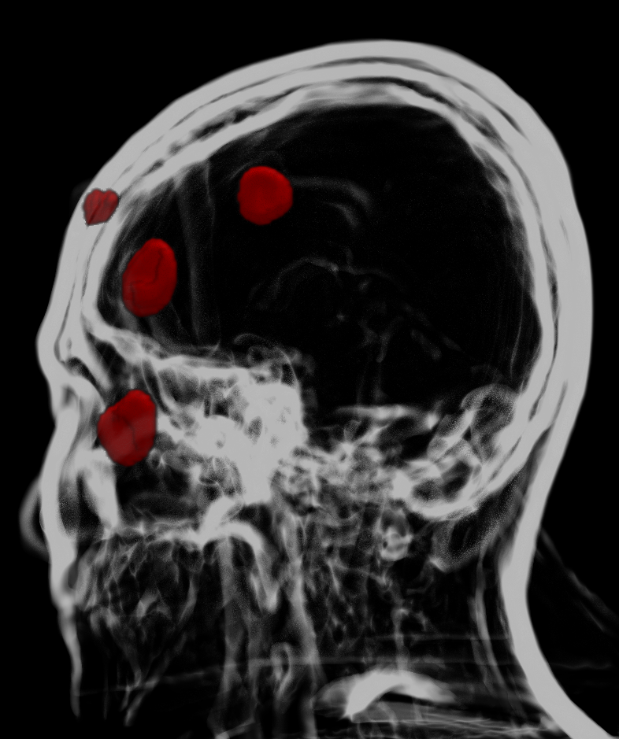

<!-- Improved compatibility of back to top link: See: https://github.com/othneildrew/Best-README-Template/pull/73 -->
<a id="readme-top"></a>
<!--
*** Thanks for checking out the Best-README-Template. If you have a suggestion
*** that would make this better, please fork the repo and create a pull request
*** or simply open an issue with the tag "enhancement".
*** Don't forget to give the project a star!
*** Thanks again! Now go create something AMAZING! :D
-->

<!-- PROJECT SHIELDS -->
<!--
*** I'm using markdown "reference style" links for readability.
*** Reference links are enclosed in brackets [ ] instead of parentheses ( ).
*** See the bottom of this document for the declaration of the reference variables
*** for contributors-url, forks-url, etc. This is an optional, concise syntax you may use.
*** https://www.markdownguide.org/basic-syntax/#reference-style-links
-->
## Contributors

- [Filip Niemann](https://github.com/LawsOfForm)
- [Steffen Riemann](https://github.com/sriemannn)

<!-- PROJECT LOGO -->
<br />
<div align="center">
  <a href="https://github.com/LawsOfForm/Automated_Electrode_Coordinate_Extraction">
    
  </a>

<h3 align="center">Automated coordinate extraction from structural MRI data for intrascanner tDCS studies: A machine-learning approach</h3>

  <p align="center">
    A fully automated pipeline that extracts tDCS electrode coordinates from structural PETRA MRI, from hand annotation to labelled coordinates.
    <br />
    <a href="https://github.com/LawsOfForm/Automated_Electrode_Coordinate_Extraction"><strong>Explore the docs »</strong></a>
    <br />
    <br />
    <a href="https://github.com/LawsOfForm/Automated_Electrode_Coordinate_Extraction">View Demo</a>
    &middot;
    <a href="https://github.com/LawsOfForm/Automated_Electrode_Coordinate_Extraction/issues/new?labels=bug&template=bug-report---.md">Report Bug</a>
    &middot;
    <a href="https://github.com/LawsOfForm/Automated_Electrode_Coordinate_Extraction/issues/new?labels=enhancement&template=feature-request---.md">Request Feature</a>
  </p>
</div>

<!-- TABLE OF CONTENTS -->
<details>
  <summary>Table of Contents</summary>
  <ol>
    <li>
      <a href="#about-the-project">About The Project</a>
      <ul>
        <li><a href="#built-with">Built With</a></li>
      </ul>
    </li>
    <li>
      <a href="#getting-started">Getting Started</a>
      <ul>
        <li><a href="#prerequisites">Prerequisites</a></li>
        <li><a href="#installation">Installation</a></li>
      </ul>
    </li>
    <li>
      <a href="#preprocessing-data">Preprocessing data</a>
      <ul>
        <li><a href="#coregistration">Coregistration</a></li>
        <li><a href="#prepare-dataset">Prepare dataset</a></li>
      </ul>
    </li>
    <li><a href="#networks">Networks</a></li>
    <li>
      <a href="#network-training">Network training</a>
      <ul>
        <li><a href="#training-locally">Training locally</a></li>
        <li><a href="#training-on-a-slurm-cluster">Training on a SLURM cluster</a></li>
      </ul>
    </li>
    <li><a href="#segmentation">Segmentation</a></li>
    <li><a href="#coordinate-extraction">Coordinate Extraction</a></li>
    <li><a href="#license">License</a></li>
    <li><a href="#contact">Contact</a></li>
    <li><a href="#acknowledgments">Acknowledgments</a></li>
  </ol>
</details>

<!-- ABOUT THE PROJECT -->
## About The Project

<!-- Built With -->
### Built with

* [](https://www.python.org)
* [](https://monai.io)
* [](https://pytorch.org)
* [](https://www.mathworks.com/products/matlab.html)

<p align="right">(<a href="#readme-top">back to top</a>)</p>

<!-- GETTING STARTED -->
## Getting Started

This repository provides a fully automated pipeline that extracts tDCS electrode coordinates from structural MRI, preferably PETRA images (Pointwise Encoding Time Reduction with Radial Acquisition). You annotate a small set of images by hand, train a 3D U-Net on them, segment the electrodes in all remaining images, and convert each segmentation into four labelled electrode coordinates.

**Which network to use.** Five 3D U-Net variants are provided. The recommended one is the **standard U-Net without attention gates (`a_baseline`)**: on 4,234 images it recovered four valid electrode coordinates from 97.7 % of images, against 89–91 % for the attention-gated variants. The difference is caused almost entirely by attention-gated networks merging two adjacent electrodes into one object. See [Networks](#networks) for all five.

The pipeline has four stages, each with its own section below:

1. **[Preprocessing](#preprocessing-data)** — coregistration and hand annotation of training images
2. **[Network training](#network-training)** — locally, or on a SLURM cluster
3. **[Segmentation](#segmentation)** — apply a trained network to all images
4. **[Coordinate extraction and analysis](#coordinate-extraction)** — turn masks into labelled coordinates, check them, and compare them with the intended montage

### Prerequisites

#### Software

You will need [python](https://www.python.org/), [matlab](https://www.mathworks.com/products/matlab.html) and [R](https://www.r-project.org/) (but you can write your own code in python to avoid matlab and R)
To create a virtual environment (recommended) use [mamba](https://mamba.readthedocs.io/en/latest/installation/mamba-installation.html).

For hand segmentation of electrodes use [3DSlicer](https://www.slicer.org/)

### Installation

#### Install CUDA (to use nvidia graphic card)

To install [CUDA](https://developer.nvidia.com/cuda-toolkit) on [Ubuntu](https://ubuntu.com/), follow these steps:
Step 1: Update and Upgrade Ubuntu
Run the following commands to ensure your system is up to date:

```sh
sudo apt update
sudo apt upgrade
```

Step 2: Install NVIDIA Drivers

Install the ubuntu-drivers-common package:

```sh
sudo apt install ubuntu-drivers-common
```

List available NVIDIA drivers:

```sh
sudo ubuntu-drivers devices
```

Install the recommended driver (e.g., nvidia-driver-535):

```sh
sudo apt install nvidia-driver-535
```

Reboot your system:

```sh
    sudo reboot now
```

Step 3: Verify Driver Installation
After rebooting, check if the NVIDIA driver is installed correctly:

```sh
nvidia-smi
```

This should display information about your GPU and driver version.
Step 4: Install CUDA Toolkit

Download and install the CUDA keyring:

```sh
wget https://developer.download.nvidia.com/compute/cuda/repos/ubuntu2204/x86_64/cuda-keyring_1.1-1_all.deb
sudo dpkg -i cuda-keyring_1.1-1_all.deb
sudo apt-get update
```

Install the CUDA toolkit:

```sh
sudo apt-get -y install cuda
```

Reboot your system again:

```sh
    sudo reboot now
```

Step 5: Set Up Environment Variables
Add CUDA paths to your .bashrc file:

```sh
echo 'export PATH=/usr/local/cuda/bin${PATH:+:${PATH}}' >> ~/.bashrc
echo 'export LD_LIBRARY_PATH=/usr/local/cuda/lib64${LD_LIBRARY_PATH:+:${LD_LIBRARY_PATH}}' >> ~/.bashrc
source ~/.bashrc
```

Step 6: Verify CUDA Installation
Check if CUDA is installed successfully by running:

```sh
nvcc -V
```

This should display the CUDA version.

#### Create Virtual environment

To install Mamba on Ubuntu, follow these steps:

Open a terminal window.
Download the Mambaforge installer script using wget:

```sh
wget https://github.com/conda-forge/miniforge/releases/latest/download/Mambaforge-Linux-x86_64.sh
```

Make the installer script executable:

```sh
chmod +x Mambaforge-Linux-x86_64.sh
```

Run the installer:

```sh
bash Mambaforge-Linux-x86_64.sh
```

Follow the prompts during installation. When asked to initialize Mamba, type 'yes'2.
Close the terminal and open a new one to apply the changes.
Verify the installation by running:

```sh
mamba --version
```

After installation, you can use Mamba to create environments and install packages. To create a new environment with the given *network.yml*, change directory to :

```sh
  (base)$ cd 'path/to/repository/'
```

create new virtual environment named 'network'

```sh
(base)$ mamba env create -f network.yml
```

Activate the virtual environment

```sh
(base)$ mamba activate network
```

If successfully installed, the 'base' environment should change to 'network' in your terminal any should be able to run the model.

```sh
(network)$ python3 model.py
```

## Preprocessing data

### Coregistration

In our case we run electric field map simulations to find optimal electrode positions, so we had baseline coordinates which we like to compare against other sessions. Therefore we coregistrated all other sessions to a baseline session. If you don't have baseline sessions, you can ignore the the coregistration.

Use the *Coregistration.m* script in the *code/Preprocess/01_coregistration*
It's used for searching a bids format and extracting all petra images of interest and generate a new dataset which can be used as *dataset* folder in the repository.

```sh
matalb Coregistrat.m
```

### Prepare dataset

Open [3DSlicer](https://www.slicer.org/) in terminal

```bash
Slicer
```

#### Dataset

Dataset has to look something like this *Repository/Dataset/dataset/..../sub-xx/unzipped/*. You can change the structure as you like but you have to adjust the path in some scripts

#### Files

If you have baseline sessions __use coregistrated images__ to later correct electrode naming more easily

In matlab coregistrated images named like this *rsub-xx_ses-x_acq-petra_run-0x_PDw.nii*

#### Process of segmenting electrodes

##### Overall procedure

1. Create a segment.
2. Get an optimal view of the electrode:
   - choose one electrode;
   - align it in the middle of the view, so that the AS and LS crosshairs lie parallel to the electrode surface. Rotate the SPR and AS images with the **Transforms** module to achieve this.
3. Paint a circular segment over the gel and the electrode.
4. Repeat for the next electrode, then export the segmentation.

> [!WARNING]
> Save between steps, as 3D Slicer can crash and lose unsaved work. Save each project in a folder named like `sub-0xx_ses-x_run-x`, and check the folder name and path every time — otherwise data will be overwritten.

##### Modules in 3D Slicer

Adding segments, grouping them and transforming images are all done through **modules**. The available modules are listed in the drop-down next to the *Modules:* icon, at the top left beside *Data*, *DCM* and *Save*. Choose one (for example *Segment Editor* or *Transforms*) and its controls appear in the panel to the left of the images.

The steps below refer to these two places as:

- **Modules drop-down** — where you select a module
- **Module panel** — where that module's controls appear

##### Step 1: Adjust the view

- In the menu bar choose **View → Layout → Four-Up**. You should now see a 2×2 window:

  | Position | Plane | Colour |
  |---|---|---|
  | upper left | SPR (horizontal) | red |
  | upper right | 3D rendering of the head (must be activated) | — |
  | lower left | AS (coronal) | green |
  | lower right | LS (sagittal) | yellow |

- Link the slice views by clicking the two rings in each window; the rings must appear closed.
- Zoom in and out with **Ctrl + mouse wheel**.

##### Step 2: Add segments

- **Modules drop-down:** choose *Segment Editor*.
- **Module panel:** click *Add* four times to create four segments.

##### Step 3: Align the electrode with transforms

- **Modules drop-down:** choose *Transforms*. The panel now shows all available image transformations.
- **Module panel:**
  - Under *Active Transform* choose *Linear transforms*.
  - Before transforming, go to *Apply transform* and select both the segment and the loaded image, so that the transformation is applied to both together.
  - Use the translation and rotation sliders to bring the electrode to the centre and align it with one crosshair.

How to judge the alignment: each view shows a vertical and a horizontal crosshair line, and in a slice the gel of the electrode also forms a line. Rotate until that line is parallel to the horizontal crosshair in exactly two views, the SPR and the AS. When it is, the gel should appear as a near-perfect circle in the LS view. Scroll to the outermost slice in which the circle is still clearly visible, and start segmenting there.

> [!TIP]
> Hover over a point in any view and hold **Shift** for a moment: the crosshairs of all views centre on that point. This is the quickest way to move to the next electrode.

##### Step 4: Segment the electrode

- **Modules drop-down:** choose *Segment Editor*.
- **Module panel:**
  - Click the segment to draw (for example *Segment_1*).
  - Click the paint icon to get a circular brush, and adjust its radius with **Shift + mouse wheel** until it exactly matches the radius of the electrode or gel.
  - Click to paint the first slice, then use the mouse wheel in the LS view to move to the next slice and repeat.
  - Use *Show 3D* to check coverage. When the gel and electrode are fully covered, move on to the next electrode.
- When all four electrodes are done, apply **Smoothing** to the segments and **Fill between slices** to close the gaps between painted slices.

**Export** the segments as `.nii`:

1. Click the small drop-down next to the green arrow, on the same line as *Add* and *Remove*.
2. Choose *Export to files*.
3. Select the correct folder and click *Export*. A file called `Segmentation.nii` should appear.

> [!TIP]
> - If an electrode is deformed or the gel has spread further than usual, reduce the brush radius to reach those areas, and use the eraser to remove anything painted in error.
> - If the brush does not paint, check that *Editable area* in the panel below is set to *everywhere*.

#### Create dataset for network

Use codes in the *repository/code/Preprocess/02_prepare_dataset* to create a *dataset.tar.gz* file which later can also be used for traning of the network on a cluster.

1) unite the 4 segmented electrodes into 3 mask with the *01_unite_mask.py* script.
Therefore change in the script

```sh
network$ python3 unite_mask.py
```

2) create dataset in which subject and mask are structured for network input

```sh
network$ python3 create_dataset.py
```

the *dataset.tar.gz* will be saved in the *02_prepare_dataset* folder. Merg or unzip the tarfile into the */repository/dataset* folder.

## Networks

All five networks are 3D U-Nets with five levels, 3×3×3 kernels and stride-2 down-sampling. They differ only in channel width and in whether attention gates are applied to the skip connections, so that a comparison between them isolates architecture.

| Key | Description | Channels | Attention | Parameters | Valid extractions* |
|---|---|---|---|---|---|
| **`a_baseline`** | **Standard U-Net — recommended** | 64–512 | no | 7.75 M | **97.69 %** |
| `b_no_attention` | Narrower channels, no attention | 32–512 | no | 7.91 M | 96.34 % |
| `c_reduced` | Attention, halved channels | 16–256 | yes | 5.91 M | 89.58 % |
| `d_increased` | Attention, widened channels | 48–768 | yes | 53.15 M | 91.24 % |
| `proposed` | Attention U-Net (original design) | 32–512 | yes | 23.63 M | 89.02 % |

\* Fraction of 4,234 images from which four electrode positions passing all plausibility checks were recovered.

Segmentation overlap (Dice) does **not** distinguish the five (one-way ANOVA, *p* = 0.28). What distinguishes them is whether the four electrodes can be separated: attention-gated variants segment two adjacent electrodes as one object in 7–9 % of images, against 1.5–2.7 % without gating. This follows attention rather than model size — the smallest network, `c_reduced`, is an attention variant and behaves like the largest.

Trained weights are in `code/Network/Paper_models/`.

<p align="right">(<a href="#readme-top">back to top</a>)</p>

## Network training

All training code is in `code/Network`. Set the `root_dataset` variable at the top of the script to your dataset. The dataset script builds paths as they appear in your source folder, so check your folder structure and replace the `dataset/media/MeMoSLAP_Subjects/derivatives/automated_electrode_extraction` path with your own.

### Training locally

```sh
(base)$ cd repository/code/Network
(base)$ mamba activate network
(network)$ python3 model.py
```

After each epoch the validation Dice is printed. The model with the best validation Dice is saved automatically; to keep it, copy it into `Paper_models/` and rename it after its network key.

### Training on a SLURM cluster

Each variant trains for 50,000 iterations, roughly 50 h on an NVIDIA A100 80 GB. On a shared cluster this is run as one job per variant and fold, inside a Singularity container that carries PyTorch and MONAI.

The layout used for the published models:

```text
~/ablation/
├── ablation_results/     # checkpoints, metrics JSON, per-fold reports
├── logs/                 # SLURM .out and .err files
├── slurm/                # job scripts
├── pytorch_monai_2.sif   # container
└── submit.sh             # submission wrapper
```

**Cross-validation** (five participant-wise folds per variant, used to compare the architectures):

```sh
$ ./submit.sh a_baseline --dataset HGW --submit
```

**Final model** (all annotated data, no held-out test set, used for deployment):

```sh
$ ./submit.sh a_baseline --dataset RU --final --submit
```

A final run builds no test set by design, and reports only a validation Dice. **That validation score selected the checkpoint and is therefore optimistic** — report the cross-validation mean as the model's performance, not a number from the final run.

**Participant-wise splitting.** Images of one participant never appear in more than one partition. An image-wise split would place near-identical images of the same head in both training and test data, which inflates every metric; the earlier Dice of 0.76 reported for this pipeline came from such a split, and the participant-wise value is 0.61.

**Slow-starting variants.** `c_reduced`, at halved channel width, needs roughly twice as many iterations before it begins to fit, and can fail the default early sanity check. Give it a longer probation:

```sh
$ ./submit.sh c_reduced --dataset HGW --sanity-probation-iters 30000 --submit
```

Check job status with `squeue -u $USER`. The partition, time limit and container path are set in `submit.sh`; adjust them to your cluster.

<p align="right">(<a href="#readme-top">back to top</a>)</p>

## Segmentation

Apply a trained network to every image. Set `root_images` at the top of the script, then:

```sh
(base)$ cd repository/code/02_Segmentation
(base)$ mamba activate network
(network)$ python3 Segmentation_ablation_final.py --network a_baseline --jobs 2 --threads 3
```

Each image gets a mask named `*_inference_<network>.nii.gz` beside it, so several networks can be run on the same data without overwriting each other. Inference runs on CPU; `--jobs` sets how many images are processed in parallel and `--threads` the threads per job. Use `--overwrite` to replace existing masks.

<p align="right">(<a href="#readme-top">back to top</a>)</p>

## Coordinate Extraction

All scripts are in `code/03_Extract_Coordinates`, and every one takes `--network` so that results for different networks are kept apart. Outputs go to `Tables/` and `Figures/`, stamped with the network name and date.

```sh
(base)$ cd repository/code/03_Extract_Coordinates
(base)$ mamba activate network
```

### 1. Extract coordinates

```sh
(network)$ python3 01_Extract_coordinate_ablation_final.py --network a_baseline
```

Turns each mask into four electrode coordinates. The mask is split into connected components, and a recovery cascade repairs the common failure cases before plausibility checks are applied:

- **five components** — one electrode split in two; the fragments are merged
- **fragmented components** — small pieces of one electrode are grouped
- **three components** — two adjacent electrodes merged into one; a split is attempted

An extraction is accepted only if the four positions form a plausible montage: no two centres closer than 15 mm, centre-to-electrode distances between 5 and 125 mm, and the four electrodes approximately coplanar. The 125 mm bound is specific to the 3×1 montages of this study; a montage with a different electrode count or radius needs its own.

The summary at the end accounts for every image: how many were accepted, and for each rejected image the reason. Output: `Tables/electrode_positions_<network>_<date>.csv`, including per-electrode volumes and montage-geometry metrics.

### 2. Name the electrodes and match them to the intended montage

```sh
(network)$ python3 02_Merge_tables_and_Corret_Naming_ablation_final.py --network a_baseline
```

Extraction returns four positions but not which is which. This step assigns the names — anode and cathodes 1–3 — by matching the configuration to the participant's intended montage with the Hungarian algorithm, then re-checks the result against the montage geometry and reverts a relabelling that would leave a cathode at the centre.

**Target and control montages.** Every participant has two optimised montages, a target and a control, which lie on opposite hemispheres. Which one was applied is not recorded in the optimisation output, so it is identified from **which side of the head the extracted electrodes lie on**. This criterion is deliberately independent of goodness of fit: choosing whichever montage fits better is circular and cannot detect its own failure. Validated against an independent record of the stimulation arm, it classified 589 of 589 images correctly.

Each output row carries a `note` column that flags any doubt about the reference montage — for example `contralateral_baseline?`. These flags concern the **reference**, not the extraction: a flagged image may have perfectly correct coordinates, and it is excluded only from analyses that compare against the intended position.

### 3. Deviation from the intended position

```sh
(network)$ python3 04_baseline_deviation.py --network a_baseline
(network)$ python3 04_baseline_deviation.py --network a_baseline --clean-only
(network)$ python3 04_baseline_deviation.py --network a_baseline --stim active --projects P3
```

Compares extracted with intended positions per electrode, session and project, and writes violin, raincloud and displacement plots. `--clean-only` drops every row carrying a note; `--exclude-note` drops only the named ones; `--stim` restricts to the sham or active arm.

### Quality control

| Script | What it checks |
|---|---|
| `05_qc_html.py` | Browsable report of every segmentation, one row per electrode on three orthogonal slices. Used for the visual screening of the corpus |
| `06_qc_naming_html.py --network a_baseline` | Every image with its assigned names and the intended positions overlaid, and a separate page collecting flagged images |
| `07_check_affines.py --network a_baseline` | Confirms each coregistered image shares the geometry of its reference T1 — the first thing to check if coordinates are rigidly offset |
| `09_fix_target_control.py --network a_baseline --dry-run` | Verifies the target/control assignment against a record of the stimulation arm, where one exists |

### Segmented volume against the expert masks

```sh
(network)$ python3 08_compare_volumes.py \
    --networks a_baseline b_no_attention c_reduced d_increased proposed \
    --gt-root <path to the annotated dataset>
```

The four electrodes are identical objects, so their segmented volume is an absolute reference that needs no per-image annotation. The script compares each network with the expert masks, paired image by image, and reports the within-image consistency against the annotation's own spread. Use the dataset the networks were trained on, so that the comparison rests on the same masks as the cross-validation.

Counting electrodes in the expert masks is less simple than it looks: a thin gap inside an electrode can split it into pieces, while an isotropic grouping step large enough to close that gap also fuses neighbouring electrodes. The script therefore bridges along one axis at a time. `inspect_gt_masks.py` names any mask that still does not contain exactly four electrodes.

<p align="right">(<a href="#readme-top">back to top</a>)</p>

<!-- LICENSE -->
## License

See [`LICENSE.txt`](LICENSE.txt) for licensing information.

<p align="right">(<a href="#readme-top">back to top</a>)</p>

<!-- CONTACT -->
## Contact

Filip Niemann filipniemann@gmail.com

Project Link: [https://github.com/LawsOfForm/Automated_Electrode_Coordinate_Extraction.git](https://github.com/LawsOfForm/Automated_Electrode_Coordinate_Extraction.git)

<p align="right">(<a href="#readme-top">back to top</a>)</p>

<!-- ACKNOWLEDGMENTS -->
## Acknowledgments

* []()
* []()
* []()

<p align="right">(<a href="#readme-top">back to top</a>)</p>

<!-- MARKDOWN LINKS & IMAGES -->
<!-- https://www.markdownguide.org/basic-syntax/#reference-style-links -->
[contributors-shield]: https://img.shields.io/github/contributors/LawsOfForm/Automated_Electrode_Coordinate_Extraction.svg?style=for-the-badge
[contributors-url]: https://github.com/LawsOfForm/Automated_Electrode_Coordinate_Extraction/graphs/contributors
[forks-shield]: https://img.shields.io/github/forks/LawsOfForm/Automated_Electrode_Coordinate_Extraction.svg?style=for-the-badge
[forks-url]: https://github.com/LawsOfForm/Automated_Electrode_Coordinate_Extraction/network/members
[stars-shield]: https://img.shields.io/github/stars/LawsOfForm/Automated_Electrode_Coordinate_Extraction.svg?style=for-the-badge
[stars-url]: https://github.com/LawsOfForm/Automated_Electrode_Coordinate_Extraction/stargazers
[issues-shield]: https://img.shields.io/github/issues/LawsOfForm/Automated_Electrode_Coordinate_Extraction.svg?style=for-the-badge
[issues-url]: https://github.com/LawsOfForm/Automated_Electrode_Coordinate_Extraction/issues
[license-shield]: https://img.shields.io/github/license/LawsOfForm/Automated_Electrode_Coordinate_Extraction.svg?style=for-the-badge
[license-url]: https://github.com/LawsOfForm/Automated_Electrode_Coordinate_Extraction/blob/master/LICENSE.txt
[linkedin-shield]: https://img.shields.io/badge/-LinkedIn-black.svg?style=for-the-badge&logo=linkedin&colorB=555
[linkedin-url]: https://linkedin.com/in/linkedin_username
[product-screenshot]: images/screenshot.png
[Next.js]: https://img.shields.io/badge/next.js-000000?style=for-the-badge&logo=nextdotjs&logoColor=white
[Next-url]: https://nextjs.org/
[React.js]: https://img.shields.io/badge/React-20232A?style=for-the-badge&logo=react&logoColor=61DAFB
[React-url]: https://reactjs.org/
[Vue.js]: https://img.shields.io/badge/Vue.js-35495E?style=for-the-badge&logo=vuedotjs&logoColor=4FC08D
[Vue-url]: https://vuejs.org/
[Angular.io]: https://img.shields.io/badge/Angular-DD0031?style=for-the-badge&logo=angular&logoColor=white
[Angular-url]: https://angular.io/
[Svelte.dev]: https://img.shields.io/badge/Svelte-4A4A55?style=for-the-badge&logo=svelte&logoColor=FF3E00
[Svelte-url]: https://svelte.dev/
[Laravel.com]: https://img.shields.io/badge/Laravel-FF2D20?style=for-the-badge&logo=laravel&logoColor=white
[Laravel-url]: https://laravel.com
[Bootstrap.com]: https://img.shields.io/badge/Bootstrap-563D7C?style=for-the-badge&logo=bootstrap&logoColor=white
[Bootstrap-url]: https://getbootstrap.com
[JQuery.com]: https://img.shields.io/badge/jQuery-0769AD?style=for-the-badge&logo=jquery&logoColor=white
[JQuery-url]: https://jquery.com
